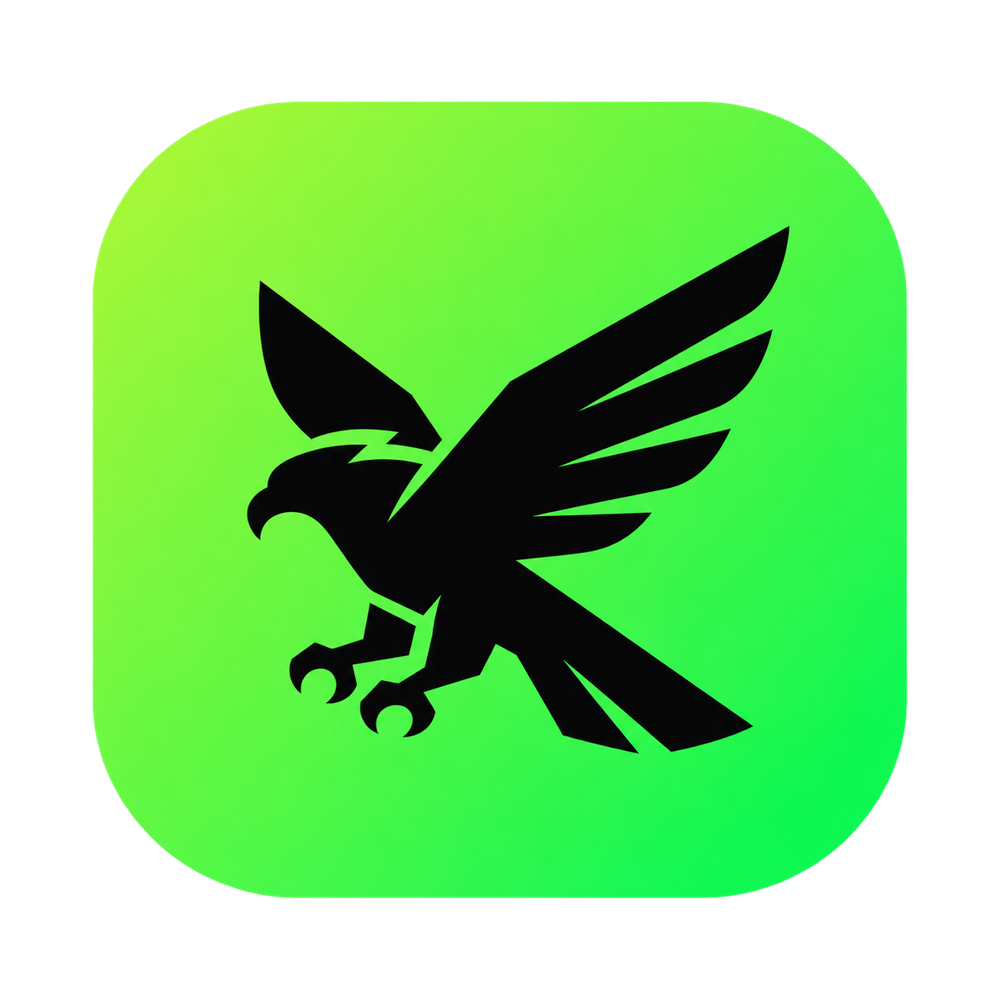
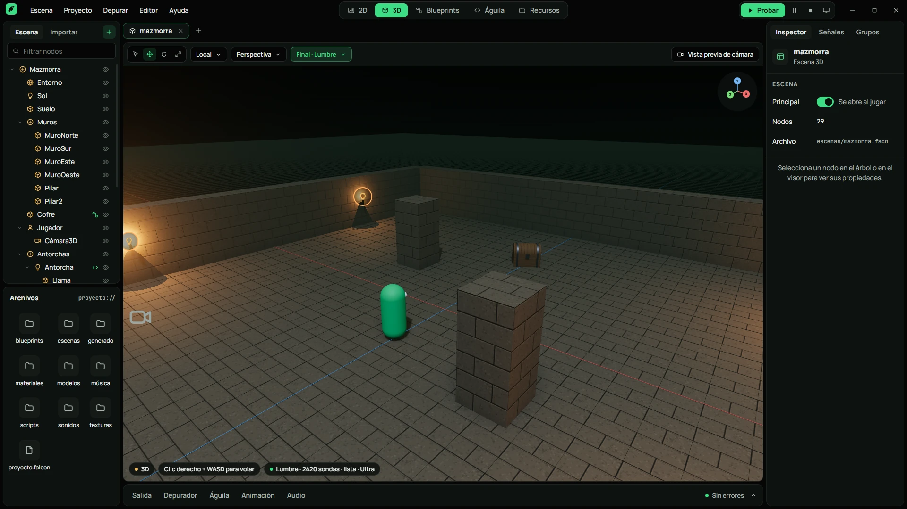
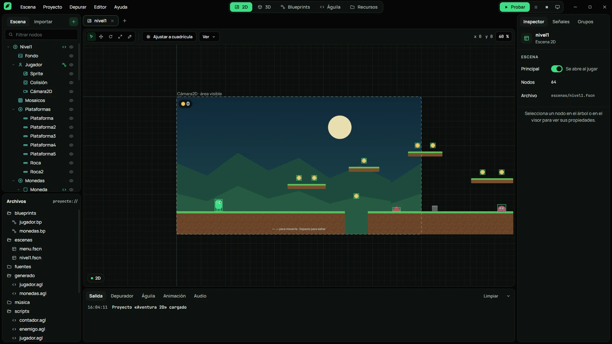
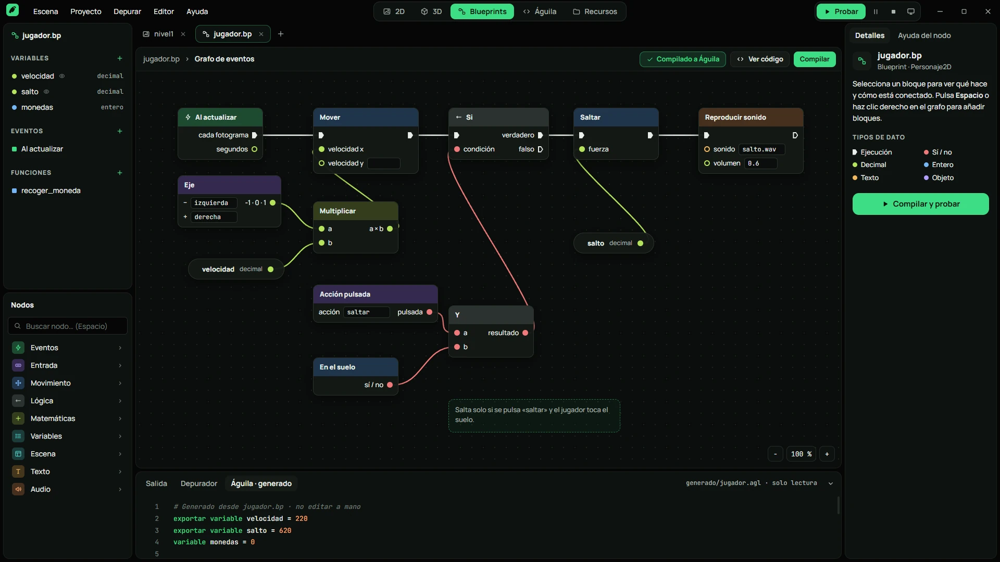
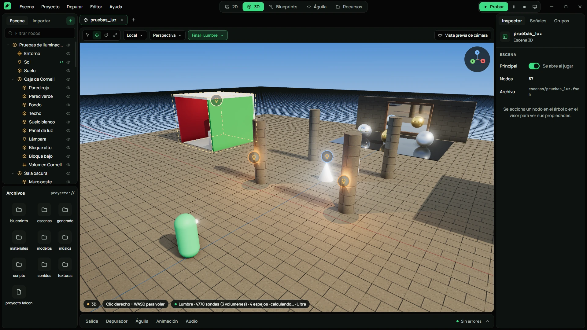
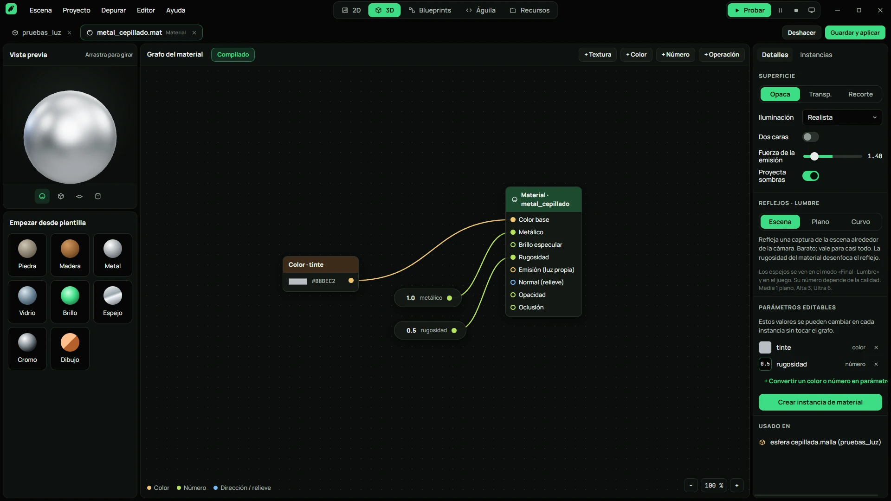
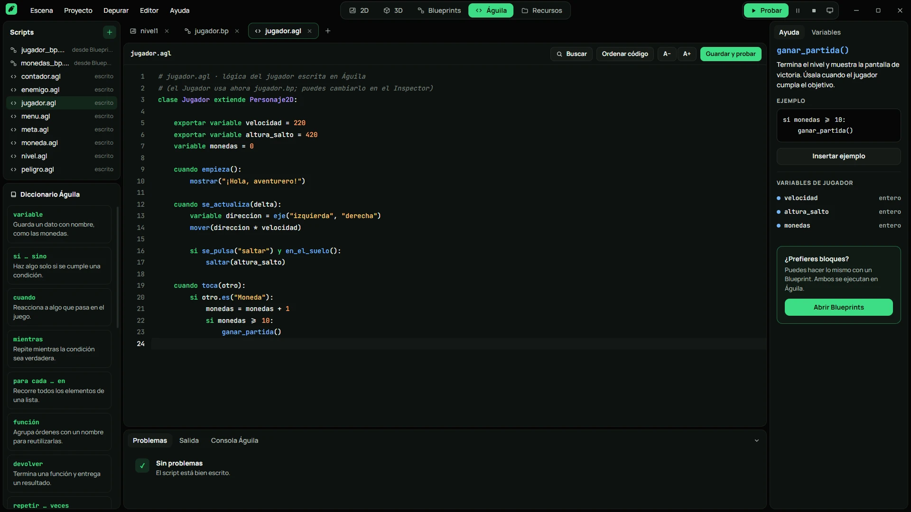
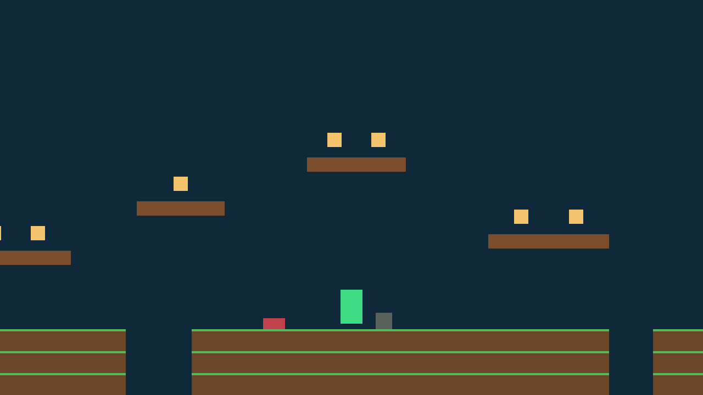

<p align="center"></p>

<h1 align="center">FALCON ENGINE — POWERED BY ARA</h1>

<p align="center"><strong>Crea tu próximo juego, en tu idioma.</strong></p>

Motor de videojuegos **2D y 3D para Windows y Linux**, con **Blueprints visuales**, scripts en español con **[Ara](https://github.com/MixdenYT/ara)** e iluminación global **Lumbre**. Construye una escena, dale comportamiento y prueba tu idea desde el mismo editor.

Falcon no es un envoltorio de otro motor. Su núcleo se está escribiendo en Ara, el lenguaje propio del proyecto:
- la física 2D, los rayos y la búsqueda de caminos 3D;
- el compilador de Blueprints;
- un primer runtime nativo que corre un nivel de Falcon en un `.exe` sin Electron.

[Web oficial](https://mixden.net/falcon-engine/) · [Instalar y probar](#instalar-y-probar) · [Capturas](#el-editor-en-imágenes) · [Ara dentro de Falcon](#ara-dentro-de-falcon) · [Exportar](#exportar-y-empaquetar) · [Documentación](#documentación)



> **En desarrollo activo.** Las capturas corresponden al editor actual. La compatibilidad y el rendimiento pueden variar según el equipo y el proyecto; lo comprobado en cada plataforma está en [`docs/PLATFORM_MATRIX.md`](docs/PLATFORM_MATRIX.md).

## Qué puedes crear

| Herramienta | Para qué sirve |
| --- | --- |
| Editor 2D | Niveles con sprites, mosaicos, colisiones y cámaras |
| Editor 3D | Escenas con mallas, materiales, luces y personajes |
| Blueprints | Lógica visual con eventos, condiciones y acciones; se compila a Ara con sus tipos |
| Ara | Scripts en español con tipos, compilados a WebAssembly, con errores en vivo |
| Águila | El lenguaje anterior: sus scripts siguen funcionando junto a los de Ara |
| Lumbre | Iluminación global mediante sondas, sombras y reflejos |
| Materiales | Grafos, vista previa, parámetros e instancias reutilizables |

## Plantillas

En **Gestor → Plantillas** hay:
- **Academia de Blueprints:** 67 laboratorios, uno por cada bloque del catálogo, con grafos comentados, pruebas y ejercicios.
- **Plataformas:** un nivel 2D.
- **Shooter · Base abierta:** tercera persona.
- **Shooter · CQB:** primera persona.
- **Pruebas de iluminación:** para Lumbre.

Cada proyecto genera su guía: `GUIA_BLUEPRINTS.md`, `GUIA_SHOOTER.md`, `GUIA_CQB.md` o `GUIA_CQB_EN.md`.

**Umbral CQB** incluye un recorrido de habitaciones y pasillos, cuatro puertas, tres enemigos, personajes originales con rig y animaciones, carabina y pistola. Su combate, inventario, puertas y victoria ejecutan Ara generado por Blueprints editables.

Para probarlo, crea un proyecto con **Shooter · CQB**, ábrelo y pulsa **F5** o **Probar**. Haz clic en la ventana para capturar el ratón.

| Tecla | Acción |
| --- | --- |
| **WASD** | Mover |
| **Alt** | Avanzar despacio |
| **Shift** | Correr |
| **Ctrl** | Agacharse |
| **Q/E** | Inclinarse |
| **Clic derecho** | Apuntar |
| **Clic izquierdo** | Disparar |
| **R** | Recargar |
| **1/2/T** | Cambiar de arma |
| **F** | Interactuar |
| **H** | Ver todos los controles |
| **L** | Alternar español e inglés |

El terminal final se activa al eliminar a los tres enemigos.

## Instalar y probar

Descarga el instalador de Windows o la AppImage de Linux x64/ARM64 desde [Releases](https://github.com/MixdenYT/Falcon-engine/releases/latest). El instalador incluye las plantillas y todos sus modelos; no necesitas Node.js para jugar.

Para trabajar desde el código necesitas **Git, Git LFS, Node.js y npm**:

```sh
git lfs install
git clone https://github.com/MixdenYT/Falcon-engine.git
cd Falcon-engine
npm install
npm start
```

Si faltan modelos o recursos tras clonar, ejecuta `git lfs pull`. `npm install` prepara las dependencias para tu plataforma.

En el gestor de proyectos, crea un proyecto 2D o 3D o elige una plantilla. Abre la escena, selecciona un nodo en el Inspector y pulsa **Probar** para ejecutar el juego. El **Modo Sencillo** y el curso **Mi primer juego** ofrecen un inicio guiado.

Para pasar las pruebas (el motor sin ventana: escenas, física, scripts, Blueprints, CQB, seguridad y el runtime nativo):

```sh
npm test
```

## El editor en imágenes

Capturas reales a **1920 × 1080**. Pulsa una imagen para verla a tamaño completo.

### Escena 2D

Organiza sprites, mosaicos, colisiones y cámaras. Ajusta tu escena en la cuadrícula y prueba el movimiento de tu personaje.



### Blueprints

Une eventos, condiciones y acciones con cables tipados. Cada Blueprint se compila a una clase de Ara, con sus tipos: consulta el código generado y, si un dato no encaja, el bloque te lo dice. El compilador de Blueprints también está escrito en Ara.



### Lumbre

Experimenta con iluminación global mediante sondas, sombras y reflejos. Ajusta la calidad de Lumbre a tu escena y a tu equipo.



### Materiales

Conecta color, metal y rugosidad en un grafo con vista previa. Crea parámetros e instancias para reutilizar tus materiales.



### Águila

El lenguaje anterior de Falcon. Las plantillas, la Academia y los Blueprints ya usan Ara; los scripts `.agl` siguen funcionando y pueden convivir con los de Ara en el mismo proyecto.



### Pantallas

1. **Gestor de proyectos:**
   - proyectos recientes con miniatura;
   - nuevo proyecto (2D, 3D o plantilla), abrir e importar;
   - curso, guías y ajustes.

   Abre proyectos de Talon Engine (`proyecto.talon`) sin conversión.
2. **Editor 2D:**
   - árbol de escena, archivos e Inspector, con Señales y Grupos;
   - visor con herramientas: seleccionar, mover, rotar, escalar y lápiz de mosaicos;
   - ajuste a cuadrícula y área de cámara.
3. **Editor 3D:**
   - gizmos y vuelo con clic derecho + WASD;
   - vistas Iluminado, Sin luz y Alambre;
   - perspectiva u ortográfica, y vista previa de la cámara del juego.
4. **Blueprints:**
   - variables, eventos, funciones y catálogo de bloques;
   - cables tipados y comentarios;
   - compilación a Ara en directo y ayuda de cada bloque.
5. **Ara y Águila:**
   - resaltado, autocompletado y formato;
   - errores en vivo en español;
   - diccionario y ayuda contextual.
6. **Recursos:**
   - carpetas, filtros e importación arrastrando archivos;
   - ajustes de importación, «Usado en» y referencias rotas.
7. **Modo Sencillo:** lo esencial del nivel y el curso «Mi primer juego», 10 lecciones que se comprueban solas.
8. **Materiales y Mallas:**
   - grafo de material con vista previa, parámetros e instancias;
   - formas básicas, LOD, colisión y física.
9. **Ventana de prueba:**
   - pausa, paso a paso y reinicio;
   - cámara libre, valores en vivo, velocidad, resolución y capturas (F12).

   Los cambios hechos en el editor llegan al juego en marcha.

## Ara dentro de Falcon

Los scripts se escriben en [Ara](https://github.com/MixdenYT/ara), un lenguaje en español parecido a Python, con tipos. El editor comprueba todo el proyecto mientras escribes y señala cada error con su archivo y su línea. Los juegos exportados llevan los scripts ya compilados, sin el compilador.

```
clase Jugador extiende Personaje2D:
    exportar velocidad = 220.0
    monedas = 0

    cuando se_actualiza(delta):
        mover(eje("izquierda", "derecha") * velocidad)
        si se_pulsa("saltar") y en_el_suelo():
            saltar()

    cuando toca(otro):
        si otro.es("Moneda"):
            monedas += 1
            otro.eliminar()
            si monedas >= 10:
                ganar_partida()

    cuando se_pulsa("pausa"):
        imprimir("Monedas:", monedas)
        esperar(0.5)
        pausar_juego()
```

Lo del nodo (`mover`, `x`, `saltar`…) se usa sin `yo.` delante, y `esperar` pausa solo ese evento. Los tipos se comprueban al compilar. Toda la API del motor está declarada en [`src/ara/motor.ara`](src/ara/motor.ara).

Al abrir un proyecto con scripts de Águila, Falcon ofrece pasarlo a Ara:
- guarda una copia en `.falcon/copia-aguila-…`;
- convierte cada `.agl` en un `.ara`;
- deja en Águila, funcionando, lo que no sepa convertir, y lo explica en `CONVERSION_ARA.md`.

También está en **Juego › Convertir los scripts de Águila a Ara…**.

### El núcleo del motor, en Ara

Además de los scripts, partes del propio motor están escritas en Ara y compiladas a WebAssembly ([`src/motor/ara/`](src/motor/ara)):
- la física 2D, con transformaciones, cajas y contactos;
- los rayos de combate, visión y cobertura;
- la búsqueda de caminos A*;
- el compilador de Blueprints ([`src/motor/ara-blueprints/`](src/motor/ara-blueprints)).

Las pruebas exigen que den exactamente el mismo resultado que el código de JavaScript al que sustituyen. Ara es además la referencia determinista: da lo mismo en todas las plataformas, cosa que `Math.sin` y `DOMMatrix` de los navegadores no garantizan.

Medido en un Snapdragon X Plus con Node 26 ([`docs/BENCHMARKS.md`](docs/BENCHMARKS.md), metodología y cifras completas):

| Qué | JavaScript / Águila | Ara | Ara es… |
|---|---|---|---|
| Bandada de 300 pájaros (lógica de script) | 59–69 ms/fotograma | 0,27–0,28 ms | 209–260× más rápido |
| Shooter con 300 drones (sobre todo llamadas al motor) | 0,25–0,29 ms | 0,19–0,22 ms | 1,2–1,5× |
| Física 2D, 200 personajes y 450 celdas de mosaico | 0,74 ms/paso | 0,19 ms | 3,9× |
| Búsqueda de caminos A*, 20 cajas | 157 µs | 40 µs | 3,9× |

### Sin Electron: el runtime nativo

[`examples/native-2d/`](examples/native-2d/README.md) es un `.exe` de Windows hecho con Ara: ventana Win32, OpenGL y teclado. Corre el nivel de la plantilla **Plataformas** con:
- la misma física que el motor;
- los mismos scripts y Blueprints: el jugador, el enemigo que patrulla, las monedas, los pinchos y la meta.

Una prueba compara ese `.exe` con Falcon paso a paso y exige el mismo resultado bit a bit. Un paso del nivel tarda 0,017 ms en el `.exe` y 0,060 ms en Falcon.



Todavía no tiene sprites, texto, audio ni el resto de la API del motor. Es el primer corte de la [fase 4 de la hoja de ruta](docs/REWRITE_ROADMAP.md).

## Lumbre

Lumbre es la **iluminación global**. Se activa en el nodo Entorno de una escena 3D.
- **La luz rebota entre superficies en tiempo real**, mediante una rejilla de sondas calculada en la GPU.
- **Cielo y reflejos:** el cielo ilumina, pero se tapa con techos y muros, y los metales reflejan la escena.
- **Efectos:** hay oclusión ambiental (GTAO) y resplandor.
- **Calidades:** Baja, Media, Alta y Ultra, más un modo Automático que reconoce la gráfica y baja de nivel si el juego va lento.

Funciona con WebGL2; donde no se puede, vuelve sola a la iluminación clásica. El jugador la cambia con **F10**, los scripts con `calidad_grafica()`, y se puede desactivar para todo el proyecto en **Proyecto › Ajustes › Gráficos**.

Incluye además:
- espejos planos y curvos;
- sombras de sol, bombillas y focos;
- nodos **Volumen Lumbre** para salas cerradas;
- exposición automática.

Para gastar poco, solo recalcula la luz cerca de lo que cambia. Qué hace exactamente y dónde está comprobado: [`docs/GRAPHICS.md`](docs/GRAPHICS.md).

**Controles 3D:** un Personaje3D puede usar tercera persona (cámara que orbita y choca con las paredes) o primera persona (vista desde los ojos, el cuerpo sigue dando sombra). Se mueve con inercia y el salto tiene altura variable. La tecla **V** cambia de vista.

## Exportar y empaquetar

**Para exportar tu juego**, abre **Proyecto › Exportar juego…** y elige Windows x64, Linux x64 o Linux ARM64. La primera exportación a otra plataforma descarga el motor de ejecución correspondiente, comprobando su suma SHA-256.

**Para empaquetar el editor** desde el código:

| Plataforma | Comando | Resultado |
| --- | --- | --- |
| Windows x64 | `npm run build:win` | `dist/Falcon Engine-win32-x64/` |
| Linux x64 | `npm run build:linux` | `dist/Falcon Engine-linux-x64.tar.gz` |
| Linux ARM64 | `npm run build:linux-arm` | `dist/Falcon Engine-linux-arm64.tar.gz` |

En Linux, descomprime el paquete y abre `./falcon.sh`. Usa `--no-sandbox` solo si el sandbox de Chromium no está disponible.

## Seguridad

Un proyecto es un archivo que alguien te puede pasar, así que el editor lo trata como no fiable:
- **Ventanas aisladas:** todas corren en sandbox y con una política de contenido sin scripts en línea.
- **Datos validados:** los datos del proyecto se escapan antes de mostrarse y se validan al cargarse.
- **Disco limitado:** el proceso principal solo deja leer y escribir en el proyecto abierto o en lo que elijas en un diálogo.
- **Juego en solo lectura:** el juego no puede escribir en el disco.
- **Permisos:** solo se conceden la captura del ratón y copiar al portapapeles.

Auditoría, hallazgos corregidos y lo que sigue abierto: [`docs/SECURITY.md`](docs/SECURITY.md).

## Actualizaciones y apoyo

**Buscar actualizaciones**, junto a la versión del gestor, consulta las releases de GitHub usando SemVer:
- muestra las notas reales agrupadas según Keep a Changelog;
- tiene los canales Estable y Pruebas;
- comprueba la suma de cada descarga antes de instalar.

Los instaladores NSIS de Windows y AppImage de Linux admiten instalación al cerrar. Consulta [ACTUALIZACIONES.md](ACTUALIZACIONES.md) para publicar versiones.

El gestor de proyectos incluye **Apoyar** con los niveles de Patreon. El pago se completa en Patreon, en el navegador. Estos controles no aparecen en el editor ni en los juegos exportados.

## Estructura

```
src/ara              Ara en Falcon: compilador (WebAssembly), API del motor (motor.ara) y puente con el juego
src/motor            Tipos de nodo, proyecto, plantillas, mundo 2D/3D, render, audio, entrada
src/motor/ara        Núcleo del motor en Ara: física 2D, rayos y A* (→ nucleo.wasm)
src/motor/ara-blueprints  Compilador de Blueprints en Ara (→ blueprints.wasm)
src/motor/nativo     API del motor escrita en Ara para el runtime nativo
src/aguila           Águila: léxico, sintaxis, intérprete, analizador y biblioteca
src/editor           Editor: estado, acciones, paneles, visores y disposiciones de cada modo
src/gestor           Gestor de proyectos
src/juego            Ventana de prueba y reproductor de juegos exportados
src/principal        Proceso principal de Electron, preloads, protocolo falcon:// y exportador
examples/native-2d   El nivel de plataformas en un .exe nativo de Ara
pruebas              Pruebas del motor sin ventana (npm test)
herramientas         Empaquetado, iconos y compilación y medida del núcleo en Ara
docs                 Documentación (abajo)
```

## Formatos de archivo

| Archivo | Contenido |
| --- | --- |
| `proyecto.falcon` | Ajustes del proyecto (JSON) |
| `*.fscn` | Escena: árbol de nodos con sus propiedades |
| `*.bp` | Blueprint; al guardar se compila a `generado/<ruta>.ara` (una clase de Ara) |
| `*.ara` | Script de Ara |
| `*.agl` | Script de Águila |
| `*.mat` | Material (grafo) o instancia de material |
| `*.malla` | Malla: modelo o forma básica, materiales, colisión y física |
| `.falcon/` | Ajustes de importación, sesión del editor y miniatura; en un juego exportado, los scripts de Ara compilados (`ara.wasm`, `ara.json`) |

## Documentación

| Documento | De qué trata |
| --- | --- |
| [REWRITE_ROADMAP](docs/REWRITE_ROADMAP.md) | Hoja de ruta de Falcon — Powered by Ara, estado real e informe de continuidad |
| [ARCHITECTURE](docs/ARCHITECTURE.md) | Procesos, motor, núcleo en Ara y capa de plataforma |
| [ARA_INTEGRATION](docs/ARA_INTEGRATION.md) | Cómo entra Ara: scripts, Blueprints, núcleo, actualización y runtime nativo |
| [BLUEPRINTS](docs/BLUEPRINTS.md) | Del grafo al código Ara |
| [GRAPHICS](docs/GRAPHICS.md) | Render 2D/3D y Lumbre, con lo comprobado en cada plataforma |
| [MIGRATION](docs/MIGRATION.md) | Qué ha pasado de JavaScript a Ara y qué queda |
| [TESTING](docs/TESTING.md) · [BENCHMARKS](docs/BENCHMARKS.md) | Pruebas y medidas reproducibles |
| [PLATFORM_MATRIX](docs/PLATFORM_MATRIX.md) · [COMPATIBILITY](docs/COMPATIBILITY.md) | Plataformas comprobadas y compatibilidad de proyectos |
| [SECURITY](docs/SECURITY.md) · [DEPENDENCIES](docs/DEPENDENCIES.md) | Auditoría de seguridad y dependencias |
| [CHANGELOG](docs/CHANGELOG.md) · [CONTRIBUTING](docs/CONTRIBUTING.md) | Cambios y cómo contribuir |

## Licencia / License

Propuesta de licencia propietaria: consulta [LICENSE](LICENSE) para los términos
en español e inglés. Permite usar distribuciones oficiales para crear y vender
juegos y distribuir el runtime necesario dentro de ellos; no concede permiso
general para redistribuir o modificar el motor o publicar su código fuente.
Los componentes de terceros conservan sus propias licencias. Los permisos
válidamente concedidos sobre versiones anteriores no se revocan.

Proposed proprietary license: see [LICENSE](LICENSE) for Spanish and English terms.
It permits using official distributions to create and sell games and distribute
the required runtime within those games, without granting a general right to
redistribute or modify the engine or publish its source. Third-party licenses
and valid earlier grants remain in effect.

[Inventario de terceros](THIRD_PARTY_NOTICES.md) · [Aplicación y revisión de la licencia](LICENSING.md)
