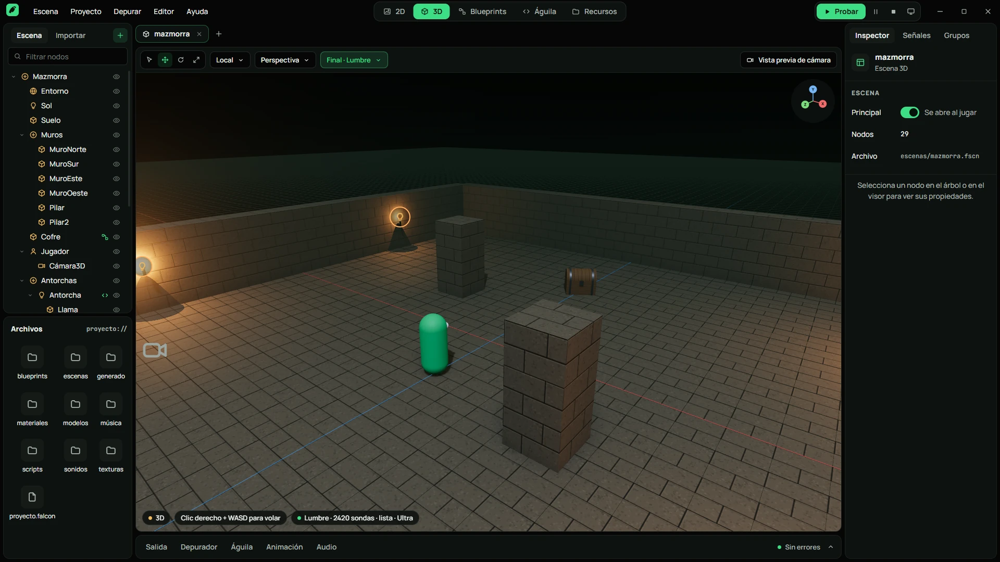
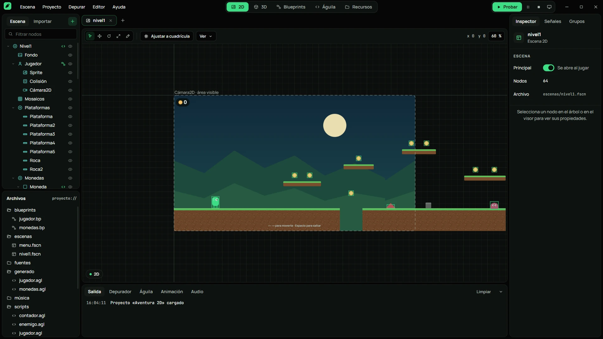
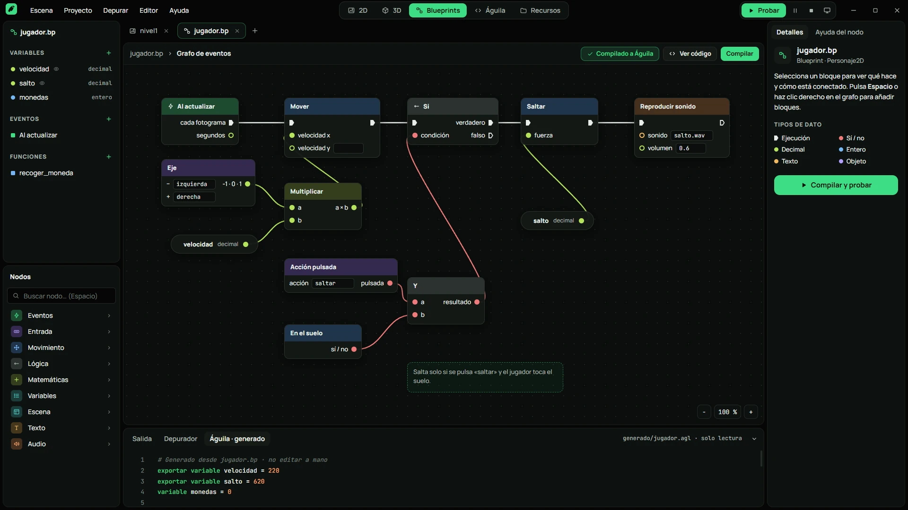
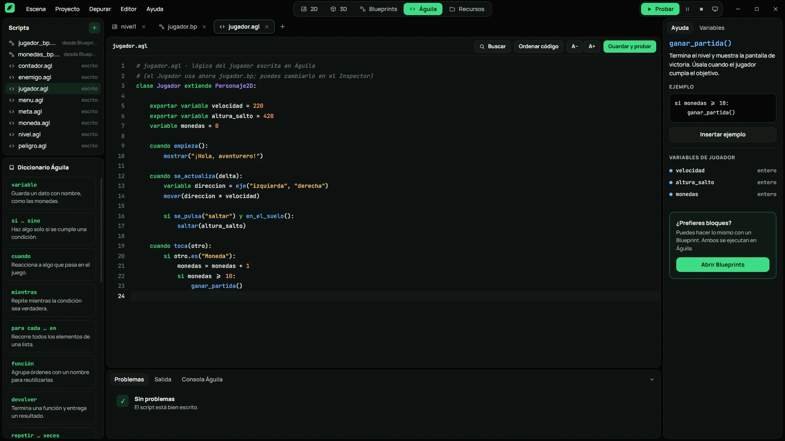
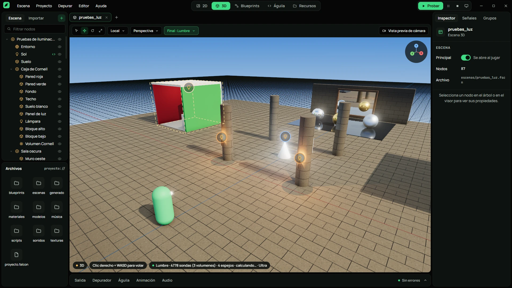
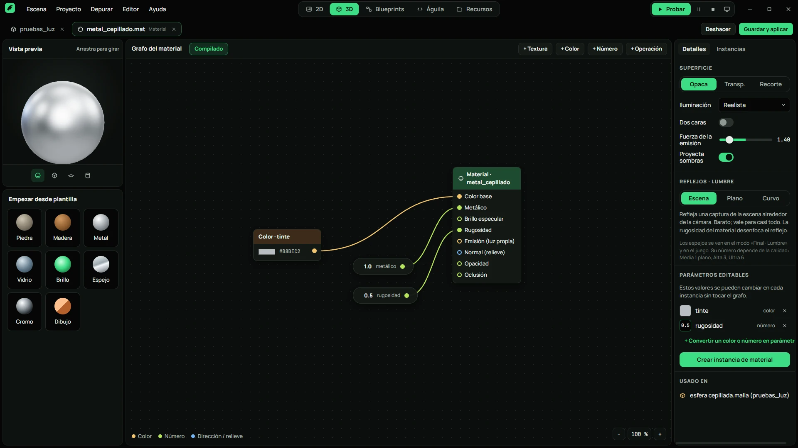

<p align="center"><strong>FALCON ENGINE</strong></p>

# Crea tu próximo juego, en tu idioma.

En **Gestor → Plantillas** encontrarás **Academia de Blueprints** (67 laboratorios, uno por cada bloque del catálogo actual, con grafos comentados, pruebas y ejercicios), **Shooter · Base abierta** (tercera persona) y **Shooter · CQB** (primera persona). **Umbral CQB** incluye un recorrido de habitaciones y pasillos, cuatro puertas, tres enemigos, personajes originales con rig y animaciones, carabina y pistola. Su combate, inventario, puertas y victoria ejecutan Águila generado por Blueprints editables. Cada proyecto genera su guía: `GUIA_BLUEPRINTS.md`, `GUIA_SHOOTER.md` o `GUIA_CQB_ES.md` y `GUIA_CQB_EN.md`.

Para probar CQB, crea un proyecto nuevo con **Shooter · CQB**, ábrelo y pulsa **F5** o **Probar**. Haz clic en la ventana para capturar el ratón. **WASD** mueve, **Alt** avanza despacio, **Shift** acelera, **Ctrl** agacha, **Q/E** inclina, **clic derecho** apunta, **clic izquierdo** dispara, **R** recarga, **1/2/T** cambia de arma y **F** interactúa. **H** muestra todos los controles y **L** alterna español e inglés. El terminal final se activa al eliminar los tres enemigos.

Motor de videojuegos **2D y 3D para Windows y Linux**, con **Blueprints visuales**, scripts en español con **Águila** e iluminación global **Lumbre**. Construye una escena, dale comportamiento y prueba tu idea desde el mismo editor.

[Web oficial](https://mixden.net/falcon-engine/) · [Instalar y probar](#instalar-y-probar) · [Capturas](#el-editor-en-imágenes) · [Exportar](#exportar-y-empaquetar)



> **En desarrollo activo.** Las capturas corresponden al editor actual. La compatibilidad y el rendimiento pueden variar según el equipo y el proyecto.

## Qué puedes crear

| Herramienta | Para qué sirve |
| --- | --- |
| Editor 2D | Niveles con sprites, mosaicos, colisiones y cámaras |
| Editor 3D | Escenas con mallas, materiales, luces y personajes |
| Blueprints | Lógica visual con eventos, condiciones y acciones; compilación a Águila |
| Águila | Scripts en español con ayuda contextual y análisis de errores |
| Lumbre | Iluminación global mediante sondas, sombras y reflejos |
| Materiales | Grafos, vista previa, parámetros e instancias reutilizables |

## Instalar y probar

Descarga el instalador de Windows o la AppImage de Linux x64/ARM64 desde [Releases](https://github.com/MixdenYT/Falcon-engine/releases/latest). El instalador incluye las plantillas y todos sus modelos; no necesitas Node.js para jugar.

Para trabajar desde el código necesitas **Git, Git LFS, Node.js y npm**, además de acceso a este repositorio si es privado. Usa una versión de Node.js compatible con las dependencias indicadas en `package.json`.

```sh
git lfs install
git clone https://github.com/MixdenYT/Falcon-engine.git
cd Falcon-engine
npm install
npm start
```

Las dependencias incluidas en el repositorio se gestionan con Git LFS. Si faltan archivos tras clonar, ejecuta `git lfs pull`. `npm install` prepara las dependencias para tu plataforma.

En el gestor de proyectos, crea un proyecto 2D o 3D o elige una plantilla. Abre la escena, selecciona un nodo en el Inspector y pulsa **Probar** para ejecutar el juego. El **Modo Sencillo** y el curso **Mi primer juego** ofrecen un inicio guiado.

Para comprobar el lenguaje y el compilador de Blueprints:

```sh
npm test
```

## Actualizaciones y apoyo

El gestor de proyectos incluye **Apoyar** y la selección de niveles de Patreon.
El pago se completa en Patreon, en el navegador. Estos controles no aparecen
en el editor ni en los juegos exportados.

**Buscar actualizaciones**, junto a la versión del gestor, consulta las releases
de GitHub usando SemVer. Muestra las notas reales agrupadas según Keep a Changelog,
los canales Estable y Pruebas, el progreso y los errores de consulta o descarga.
Los instaladores NSIS de Windows y AppImage de Linux admiten instalación al
cerrar; los paquetes portátiles anteriores ofrecen descarga manual.

Consulta [ACTUALIZACIONES.md](ACTUALIZACIONES.md) para publicar los instaladores,
sus metadatos y las notas de versión. La versión publicada y el tag deben coincidir
con la versión del paquete. La **1.2.0** incorpora Umbral CQB.

## El editor en imágenes

Capturas reales a **1920 × 1080**. Pulsa una imagen para verla a tamaño completo.

### Escena 2D

Organiza sprites, mosaicos, colisiones y cámaras. Ajusta tu escena en la cuadrícula y prueba el movimiento de tu personaje.



### Blueprints

Une eventos, condiciones y acciones con cables tipados. Compila tu grafo a Águila y consulta el código generado.



### Águila

Escribe scripts con palabras como cuando, variable y si. Usa el diccionario, la ayuda contextual y el análisis de errores del editor.



### Lumbre

Experimenta con iluminación global mediante sondas, sombras y reflejos. Ajusta la calidad de Lumbre a tu escena y a tu equipo.



### Materiales

Conecta color, metal y rugosidad en un grafo con vista previa. Crea parámetros e instancias para reutilizar tus materiales.



## Exportar y empaquetar

**Para exportar tu juego**, abre **Proyecto › Exportar juego…** y elige Windows x64, Linux x64 o Linux ARM64. La primera exportación a otra plataforma descarga el motor de ejecución correspondiente.

**Para empaquetar el editor** desde el código:

| Plataforma | Comando | Resultado |
| --- | --- | --- |
| Windows x64 | `npm run build:win` | `dist/Falcon Engine-win32-x64/` |
| Linux x64 | `npm run build:linux` | `dist/Falcon Engine-linux-x64.tar.gz` |
| Linux ARM64 | `npm run build:linux-arm` | `dist/Falcon Engine-linux-arm64.tar.gz` |

En Linux, descomprime el paquete y abre `./falcon.sh`. Usa `--no-sandbox` solo si el sandbox de Chromium no está disponible.

## Pantallas

1. **Gestor de proyectos** — proyectos recientes con miniatura, nuevo proyecto (2D, 3D o plantilla), abrir, importar, plantillas, curso, guías y ajustes. Abre proyectos de Talon Engine (`proyecto.talon`) sin conversión.
2. **Editor 2D** — árbol de escena, archivos, visor con herramientas (seleccionar, mover, rotar, escalar, lápiz de mosaicos), ajuste a cuadrícula, área de cámara, Inspector, Señales y Grupos.
3. **Editor 3D** — visor three.js con gizmos, vuelo con clic derecho + WASD, iconos de luces y cámaras, Iluminado / Sin luz / Alambre, perspectiva / ortográfica, vista previa de la cámara del juego.
4. **Blueprints** — variables, eventos, funciones, catálogo de bloques, grafo con cables tipados, comentarios, compilación a Águila en directo y ayuda de cada bloque.
5. **Águila** — editor con resaltado, autocompletado, errores en español con «Arreglar», ordenar código, buscar, diccionario y ayuda contextual.
6. **Recursos** — carpetas, filtros, importación arrastrando archivos, ajustes de importación (píxel/suave, hoja de sprites…), «Usado en» y referencias rotas.
7. **Modo Sencillo** — lo esencial del nivel y el curso «Mi primer juego» (10 lecciones con pasos que se comprueban solos).
8. **Materiales** — grafo de material con vista previa y plantillas, parámetros e instancias.
9. **Mallas** — formas básicas, ranuras de material, LOD, colisión y física.
10. **Ventana de prueba** — pausa, paso a paso, reinicio, silencio, cámara libre, valores en vivo, velocidad, resolución y capturas (F12). Los cambios hechos en el editor llegan al juego en marcha.

**Iluminación global «Lumbre»** (inspirada en Lumen de Unreal): se activa en el nodo Entorno de una escena 3D. La luz rebota entre superficies en tiempo real mediante una rejilla de sondas calculada en la GPU, el cielo ilumina pero se tapa con techos y muros, los metales reflejan la escena, y hay oclusión ambiental (GTAO) y resplandor. Hay cuatro calidades (Baja, Media, Alta y Ultra) y un modo Automático que reconoce la gráfica (una RTX 2060 va a Alta) y baja de nivel si el juego va lento. Funciona con WebGL2 en cualquier gráfica de NVIDIA, AMD o Intel; donde no se puede, vuelve sola a la iluminación clásica. El jugador la cambia con F10 y los scripts con `calidad_grafica()`. Lumbre se puede desactivar para todo el proyecto en Proyecto › Ajustes › Gráficos, y el jugador también puede apagarla en el menú F10.

Lumbre también incluye espejos (reflejo **plano**, con cámara reflejada, y **curvo**, con sonda propia por objeto; se eligen en el material o en el Inspector), sombras de sol, bombillas y focos sobre mallas y personajes (la sombra del sol sigue a la cámara), y nodos **Volumen Lumbre** con más sondas para salas cerradas. La plantilla **Pruebas de iluminación** reúne una Caja de Cornell, una sala oscura con ventana, espejos, neón, esferas de rugosidad × metal, luz que gira, antorchas y día/noche con la tecla E.

Para gastar poco, Lumbre solo recalcula la luz cerca de lo que cambia (luces que se mueven, el sol, objetos desplazados), usa una versión simplificada de la escena para calcular las sondas, redibuja cada sombra solo cuando algo se mueve cerca y no dibuja los espejos que no se ven. Con la escena quieta apenas gasta medio milisegundo por fotograma. Las sondas que caen dentro de muros se sacan fuera para que la luz no se cuele, y la **exposición automática** adapta la imagen al entrar en sitios oscuros.

**Controles 3D**: un Personaje3D puede usar controles de **tercera persona** (cámara que orbita con el ratón o el mando, rueda para acercar, choca con las paredes y sigue con suavidad) o de **primera persona** (vista desde los ojos, el cuerpo sigue dando sombra). Movimiento con inercia, salto con margen al borde y altura variable, y la tecla V cambia de vista.

**Exportar** (Proyecto › Exportar juego…) crea un juego independiente para Windows x64 (carpeta con `.exe`), Linux x64 y Linux ARM64 (`.tar.gz` con permisos). La primera exportación a otra plataforma descarga su motor de ejecución.

## Águila en un vistazo

```
clase Jugador extiende Personaje2D:
    exportar variable velocidad = 220
    variable monedas = 0

    cuando se_actualiza(delta):
        mover(eje("izquierda", "derecha") * velocidad)
        si se_pulsa("saltar") y en_el_suelo():
            saltar()

    cuando toca(otro):
        si otro.es("Moneda"):
            monedas = monedas + 1
            otro.eliminar()
            si monedas >= 10:
                ganar_partida()
```

Bloques por sangría, `si / sino si / sino`, `mientras`, `para cada … en`, `repetir N veces`, `función`, `devolver`, clases, listas y diccionarios, y `esperar(segundos)` dentro de los eventos sin congelar el juego. `y` y `o` funcionan como operadores entre valores y como nombres normales (la coordenada `y`) en cualquier otro sitio.

## Estructura

```
src/aguila      Lenguaje: léxico, sintaxis, intérprete, analizador y biblioteca
src/motor       Tipos de nodo, Blueprints, proyecto, plantillas, mundo 2D/3D, render, física, audio, entrada
src/editor      Editor: estado, acciones, paneles, visores y disposiciones de cada modo
src/gestor      Gestor de proyectos
src/juego       Ventana de prueba y reproductor de juegos exportados
src/principal   Proceso principal de Electron, puente seguro y exportador
pruebas         Pruebas del lenguaje y del compilador de Blueprints
herramientas    Empaquetado e iconos
```

## Formatos de archivo

| Archivo | Contenido |
| --- | --- |
| `proyecto.falcon` | Ajustes del proyecto (JSON) |
| `*.fscn` | Escena: árbol de nodos con sus propiedades |
| `*.bp` | Blueprint; al guardar se compila a `generado/*.agl` |
| `*.agl` | Script de Águila |
| `*.mat` | Material (grafo) o instancia de material |
| `*.malla` | Malla: modelo o forma básica, materiales, colisión y física |
| `.falcon/` | Ajustes de importación, sesión del editor y miniatura |

## Licencia / License

Propuesta de licencia propietaria: consulta [LICENSE](LICENSE) para los términos
en español e inglés. Permite usar distribuciones oficiales para crear y vender
juegos y distribuir el runtime necesario dentro de ellos; no concede permiso
general para redistribuir o modificar el motor o publicar su código fuente.
Los componentes de terceros conservan sus propias licencias. Los permisos
válidamente concedidos sobre versiones anteriores no se revocan.

Proposed proprietary license: see [LICENSE](LICENSE) for Spanish and English terms.
It permits using official distributions to create and sell games and distribute
the required runtime within those games, without granting a general right to
redistribute or modify the engine or publish its source. Third-party licenses
and valid earlier grants remain in effect.

[Inventario de terceros](THIRD_PARTY_NOTICES.md) · [Aplicación y revisión de la licencia](LICENSING.md)

