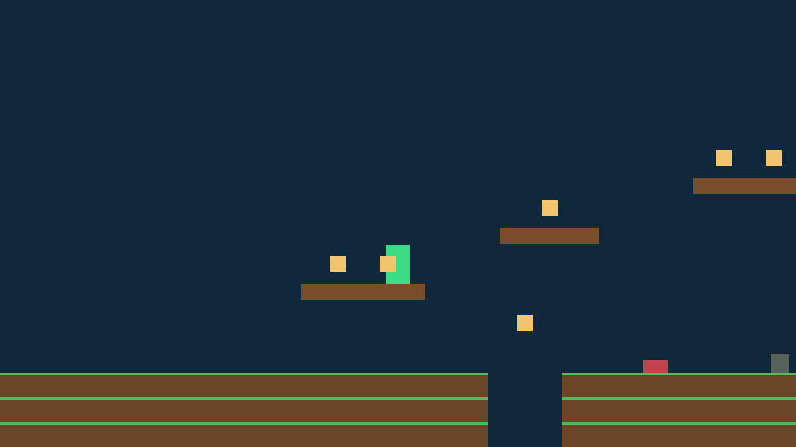

# Falcon nativo 2D: primer corte de la fase 4

El nivel de la plantilla «plataformas» corre en un `.exe` de Windows x64 hecho en Ara, sin Electron ni JavaScript.



- **Ventana.** Win32, con la función de ventana escrita en Ara y dada a Windows con `retrollamada`.
- **Dibujo.** OpenGL 1.1: rectángulos de color (`glRectd`) con una cámara que sigue al jugador. Se dibujan:
  - las celdas de los mosaicos;
  - las plataformas;
  - las monedas, los pinchos, el enemigo y la meta;
  - el jugador.
- **Entrada.** Teclado con `GetAsyncKeyState`: ← → o A/D para andar, y Espacio, ↑ o W para saltar.
- **Tiempo.** Física a paso fijo de 1/60 s con el reloj real (`QueryPerformanceCounter`), hasta 5 pasos por fotograma.
- **Física.** La del motor: `src/motor/ara/fisica2d.ara`, el mismo fuente que Falcon compila a `nucleo.wasm`. El `.exe` lo importa (`importar fisica2d`); no hay una copia reescrita.

## Compilar y jugar

Hace falta Windows (x64, o ARM64 con la emulación x64) y el repositorio de Ara con su `ara.exe` (`motor-ara`, `7e4e99b` o posterior):

```sh
node herramientas/escena-nativa-2d.mjs          # deja examples/native-2d/build/falcon-2d.exe
examples/native-2d/build/falcon-2d.exe          # jugar; se cierra con la ventana
```

- Por defecto, Ara se busca en `../ara-etapa5/ara` junto a Falcon. Con otra ruta, usa `ARA_DIR`; con otro binario, `ARA`.
- El script hace tres cosas:
  1. genera `build/escena.ara` desde la plantilla;
  2. copia junto a `juego.ara` los módulos que importa: `fisica2d.ara` del motor y `nativo/bufer.ara` de Ara;
  3. compila con `printf "runtime …\nwasm …\nnativo …" | ara compilador/ara.ara`.
- `build/` no va en git.

Modos sin teclado (variables de entorno):

| Variable | Qué hace |
|---|---|
| `FALCON_PASOS=N` | Sin ventana. Da N pasos con la entrada del guion y escribe el estado final y los ms por paso. |
| `FALCON_PASOS=N` y `FALCON_TRAZA=1` | Igual, pero escribe el estado tras cada paso. Lo usa la prueba. |
| `FALCON_CAPTURA=ruta.bmp` | Con ventana. Juega el guion 150 pasos, guarda el fotograma con `glReadPixels` y se cierra. |

La captura de arriba sale de `FALCON_CAPTURA`, pasada a PNG.

## La escena: un atajo

- Ara no tiene JSON en su biblioteca. Por eso el `.exe` no lee el `.fscn`: `herramientas/escena-nativa-2d.mjs` genera un módulo de Ara (`escena.ara`).
- El módulo lleva lo que `Mundo.sincronizarAra` le manda al núcleo para ese nivel, grabado tal cual. Lleva también los colores, las celdas, la velocidad y el salto del Blueprint del jugador, y `0.02^dt`.
- Así el `.exe` parte del mismo estado que el motor. Para otra escena hay que volver a compilar.
- Está marcado con `shortcut:` en el script.

## Prueba

`pruebas/nativo-2d.test.js` compila el `.exe` en una carpeta temporal y lo ejecuta con `FALCON_PASOS=900 FALCON_TRAZA=1`. Después compara cada paso, bit a bit, con la ruta wasm de Falcon: `Mundo.fisica2d` y `contactos2d` con el núcleo, la misma escena y el mismo guion. Compara:
- posición, `vy`, empujes, suelo y nodo de suelo de cada personaje;
- los pares de `contactos2d`.

Sin Windows o sin el compilador de Ara, la prueba se salta con un aviso.

## Qué cubre y qué no

Cubre:
- la física 2D completa del núcleo: plataformas, mosaicos, paredes, techos y los pares de contactos;
- andar y saltar como el Blueprint del jugador de la plantilla.

No cubre todavía:
- **sprites, texturas ni texto**: todo son rectángulos de color, y no hay interfaz ni contador;
- **audio**;
- **scripts y Blueprints.** El enemigo no patrulla, las monedas no se recogen, los pinchos no matan y la meta no hace nada. Los pares de contactos se calculan, pero nadie los usa;
- **plataformas móviles**: el arrastre va a 0, porque en este nivel no hay ninguna;
- **cargar escenas sin recompilar**: ver «La escena: un atajo»;
- **otras plataformas**: la FFI de Ara solo existe para Windows x64, así que no hay Linux ni ARM64 nativo.
